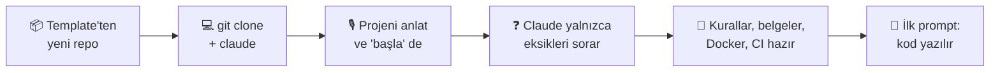

<div align="center">

# 🦴 Claude Proje İskeleti

**Projeni anlat, "başla" de. Claude sorularını sorsun, kurallarını yazsın, yığınını kursun.**
**İlk prompt'unda kod, senin kurallarınla yazılsın.**

[](https://claude.com/claude-code)
[](#-hazır-yığınlar)
[](#-hazır-yığınlar)
[](#-hazır-yığınlar)
[](#-hazır-yığınlar)
[](#)
[](CHANGELOG.md)
[](LICENSE)

</div>

---

Yapay zekâyla proje başlatmanın en yavaş kısmı kod değil, **bağlamdır**:
- ürün ne?
- kim ne yapabilir?
- hangi kurallar geçerli?
- testler nerede çalışır?
- veri nasıl korunur?

Bu iskelet o kısmı bir sohbete indirir. Projeyi bir kez anlatırsın; Claude eksikleri sorar ve projenin kendi iskeletini kurar: kurallar, mantık belgeleri, Docker ortamı, testler, CI. Sonra tek bir prompt'la kod yazılmaya başlar.

**İçindekiler:** [Nasıl çalışır](#-nasıl-çalışır) · [Kurallar](#️-kurallar-claude-neye-uyar) · [Bekçiler](#-bekçiler-kurallar-yalnızca-metin-değil) · [Kayıtlar](#-kayıtlar-proje-neyi-hatırlar) · [Mantık belgeleri](#-mantık-belgeleri-ürünün-sözleşmesi) · [Skill'ler](#-skilller) · [Hazır yığınlar](#-hazır-yığınlar) · [Komutlar](#️-günlük-komutlar) · [Sürümler](#-sürümler)

## ✨ Nasıl çalışır?



### 1. Template'ten yeni repo aç
**[👉 Bu template ile yeni repo oluştur](https://github.com/yilmazaygin/claude-project-skeleton-tr/generate)**. Ya da repo sayfasında **Use this template → Create a new repository**.

### 2. Bilgisayarına al ve Claude Code'u aç
```bash
git clone git@github.com:<sen>/<yeni-proje>.git
cd <yeni-proje>
claude
```

### 3. Projeni anlat, "başla" de
Mikrofonu aç, istediğin kadar uzun anlat. Dağınık olabilir; Claude toparlar:

> *"Restoranlar için bir QR menü sitesi yapacağım. Laravel olsun. Bir süper admin olacak, işletmeleri o ekleyecek. Her işletme kendi menüsünü düzenleyecek; kategoriler, ürünler, fiyatlar. Müşteri masadaki QR'ı okutunca menüyü telefonda görecek. Tasarım sade ve modern olsun… başla."*

### 4. Claude sorar, sen seçersin
Claude önce **anladıklarını** özetler, sonra yalnızca anlatmadıklarını sorar. Sorular şıklıdır, ilk şık önerisidir:

```text
? Süper admin işlemleri değiştirilemez bir denetim kaydına yazılsın mı?
  ❯ Evet, denetim kaydı açılsın (Önerilen)
    Hayır, basit bir site
? Yedekler nereye alınsın?
  ❯ Sunucu klasörü + Backblaze B2 uzak kopya (Önerilen)
    Yalnızca sunucu klasörü
```

Sonra projeye özel **kurallar** ("her işletme yalnızca kendi menüsünü görür"), tekrar eden işler için **skill'ler** ve **mantık belgeleri** önerir. Belgeleri seninle birlikte, sözleşme soruları sorarak yazar: kim neyi yapabilir, hangi durumlar var, kenar durumlarda ne olur.

### 5. İlk prompt
Onboarding bitince elinde `docs/proje/ilk-istem.md` olur. Bu dosyayı birlikte yazarsınız: hedef, sayfalar, tasarım, kapsam dışı, "bitti" ölçütü. Hazır olduğunda:

> **"docs/proje/ilk-istem.md dosyasını uygula."**

Kod oluşur, konteynerler açılır, testler çalışır. Hepsi senin kurallarınla.

## 🧱 `/basla` sonunda projende neler olur?

```text
yeni-proje/
├── CLAUDE.md                     projeni anlatan giriş dosyası
├── .claude/
│   ├── rules/                    her oturumda geçerli kurallar (+ projeye özel olanlar)
│   ├── skills/                   /yigin, /kural, /changelog, /td ...
│   ├── hooks/                    kuralları zorlayan bekçiler
│   └── iskelet.json              açık korumalar, sürüm, kaldırılanlar
├── docs/
│   ├── proje/hakkinda.md         ürün, roller, kapsam
│   ├── proje/yigin.md            yığın, portlar, servisler
│   ├── proje/ilk-istem.md        ilk prompt'un
│   ├── mantik/*.md               davranışların sözleşmeleri
│   └── kayitlar/                 değişiklik ve teknik borç defterleri
├── compose.local.yaml            yerel ortam (canlıya çok benzer)
├── compose.live.yaml             canlı ortam
├── Makefile                      make up / test / lint / doctor / ci
└── .github/workflows/test.yml    her push'ta testler
```

Kullanılmayan her şey silinir: açılmayan isteğe bağlı kurallar, istemediğin çekirdek kurallar, gereksiz skill'ler. Silinenler iskelette durur; istersen geri gelir.

## 🛡️ Kurallar: Claude neye uyar?

Kurallar `.claude/rules/` altındadır ve Claude Code bunları **her oturumda kendiliğinden** yükler. Her dosya tek bir davranışı anlatır; kısa cümlelerle ve `kötü` / `iyi` örnekleriyle.

| Kural | Ne der | Neden |
|---|---|---|
| 🤝 **Dürüstlük** (`durustluk.md`) | Uydurma yok. Emin olunmayan şey kesinmiş gibi söylenmez. Çalıştırılmayan test "geçti", okunmayan dosya "görüldü" sayılmaz. | "Testler geçti" cümlesine güvenebilmen için. |
| ❓ **Soru** (`soru.md`) | Belirsizlikte şıklı soru sorulur; ilk şık Claude'un önerisidir. Yığın, veri modeli, silme, canlıya çıkış gibi büyük kararlar sana kalır. | Kritik kararlar senin onayından geçer. |
| 🗺️ **Plan** (`plan.md`) | Geniş ya da tek cümleyle tarif edilemeyen işte önce plan modu. Plan onaylanmadan kod yazılmaz. | Yanlış yöne giden bir saatlik iş, iki dakikalık bir onayla önlenir. |
| 📁 **Kapsam** (`kapsam.md`) | Proje klasörünün dışına çıkılmaz; başka bir yol ancak sen açıkça verirsen. | Diğer projelerin ve dosyaların güvende kalır. |
| 🔒 **Git** (`git.md`) | Git salt okunur: `status`, `log`, `diff`, `show`. Commit ve push senin işin. | Geçmişin her zaman senin kontrolünde. |
| 🗄️ **Veri** (`veri.md`) | Veritabanı ve hacimler silinmez. Testler ayrı bir `testing` veritabanında çalışır. `.env` ve `.env.example` dosyasına gerçek anahtar yazılmaz; iki dosya aynı anahtarları aynı sırada taşır. | Geliştirme verin ve gizli değerlerin korunur. |
| 🐳 **Docker** (`docker.md`) | PHP, Node, Python bilgisayarda değil projenin konteynerinde çalışır. Günlük işler Makefile hedefleriyle yapılır. Konteyner adları `<proje>-<servis>` biçimindedir. SSH kurulmaz. | "Benim makinemde çalışıyordu" sorunu olmaz. |
| 🎯 **Etki** (`etki.md`) | Davranış değişince o davranışın testleri çalışır; ilgili arayüz aynı işte güncellenir. Backend'den kalkan özellik frontend'de kalamaz. | Yarım kalmış özellik birikmez. |
| 📐 **Mantık belgeleri** (`mantik-belgeleri.md`) | Bir davranışın belgesi varsa önce o okunur. Belgeler seninle birlikte yazılır; cevapsız sorular belgede açık kalır, kodda tahmin edilmez. | Claude ürünü uydurmaz, senin kurallarınla yazar. |
| 📒 **Kayıtlar** (`kayitlar.md`) | Her değişiklik deftere tek satır yazılır; atlanan iş teknik borç olarak kaydedilir. Defterler yalnızca alta eklenir. | Ne yapıldığı ve ne eksik kaldığı hiç kaybolmaz. |
| 🤖 **Alt ajan** (`alt-ajan.md`) | Keşif ve paralel inceleme için alt ajan kullanmak serbest ve teşvikli. | Büyük işler daha hızlı ve daha derin incelenir. |

`/basla` bunlara **projeye özel kurallar** ekler. Örnek: "her işletme yalnızca kendi menüsünü görür", "fiyatlar kuruş olarak tamsayı tutulur".

## 🔐 Bekçiler: kurallar yalnızca metin değil

`.claude/hooks/` altındaki iki bekçi, Claude'un her araç çağrısından **önce** çalışır. Kuralı çiğneyen işlemi reddeder ve nedenini Claude'a söyler:

| Bekçi | Neyi durdurur |
|---|---|
| `bash_bekci.py` | `git commit`, `git push` ve bütün yazan Git komutları (`git -C`, `bash -c "…"`, `$( )` içinde gizlense de); `ssh`, `scp`, `sftp`; `docker compose down -v`, `docker volume rm`, `docker system prune`; defterin üzerine yazma (`>`); `.env.example` dosyasına bash ile yazma |
| `dosya_bekci.py` | defterlerde eski satırı değiştirmek (yalnızca alta eklenir); `.env.example` dosyasına değer yazmak |

- **Açıp kapatma:** hangi korumanın açık olduğu `.claude/iskelet.json` dosyasındadır. Bir kural istemiyorsan, örneğin Git salt okunur olmasın diyorsan, `/basla` sırasında söylemen yeterli: kural ve bekçisi birlikte kapanır.
- **Claude kendi kendine kapatamaz:** bu ayar dosyasına bash ile yazılamaz, Edit ile yapılan her değişiklik sana onaylatılır.
- **Testli:** bekçiler 112 testle sınanır (`python3 .claude/hooks/hook_testleri.py`).

## 📒 Kayıtlar: proje neyi hatırlar?

Claude bir oturumdan ötekine hafıza taşımaz, **defterler taşır**. İkisi de `docs/kayitlar/` altındadır, yalnızca alta eklenir ve eski satır asla düzenlenmez. Düzeltme de yeni bir kayıttır.

**Değişiklik defteri** (`degisiklikler.md`): yapılan her ayrı değişiklik tek satırdır. Claude bunu `/changelog` skill'iyle, sen istemesen de yazar.

```text
2026-11-24 14:05 | backend | eklendi | işletme sahibi menü kategorilerini sürükleyerek sıralayabiliyor
2026-11-24 14:20 | frontend | değişti | menü sayfası koyu temada da okunur hale geldi
```

**Teknik borç defteri** (`teknik-borclar.md`): bir iş eksik bırakılacaksa (atlanan bir test, güncellenmeyen bir sayfa) borç olarak yazılır (`/td`). Her borcun kalıcı bir kimliği (`TD-001`) ve adı vardır. Kapsam değişince aynı kimlikle alta yeni kayıt eklenir. `kapandı` yalnızca iş bitince yazılır.

```markdown
### TD-003 — menü önizleme testi — 2026-11-24 15:10
- Ad: menü önizleme testi
- Durum: açık
- Borç: QR önizleme sayfasının mobil görünüm testi yok
```

Saat tahmin edilmez, her kayıtta `date` ile okunur.

## 📐 Mantık belgeleri: ürünün sözleşmesi

`docs/mantik/` altında her davranışın bir belgesi olur: `yetkilendirme.md`, `menu-yapisi.md`, `qr-kod-uretimi.md` gibi.
- **Belge önce okunur:** Claude kod yazmadan önce belgeyi okur. Belge ile kod çelişirse durur ve hangisinin geçerli olduğunu sorar.
- **Birlikte yazılır:** belgeyi Claude tahminle doldurmaz. Önce sözleşme sorularını sorar: kim neyi yapabilir, hangi durumlar var, veri kuralları neler, kenar durumlarda ne olur.
- **Cevapsız sorular:** cevaplanmayan her soru "Açık sorular" bölümünde kalır. O konuda kod yazılırken tahmin yapılmaz, sorulur.

```markdown
## Kurallar
- Fiyat kuruş olarak tamsayı tutulur; arayüzde iki ondalıkla ve TL simgesiyle gösterilir.
- Askıya alınan işletmenin menüsü ziyaretçiye "geçici olarak kapalı" mesajı gösterir.
## Açık sorular
- Bir ürün birden çok kategoride görünebilir mi?
```

## 🧰 Skill'ler

| Komut | Ne yapar |
|---|---|
| `/basla` | Onboarding: anlatımını dinler, eksikleri sorar, projenin iskeletini kurar, ilk prompt'u birlikte yazar. Bir kez çalışır. |
| `/yigin` | Yığını seçer veya değiştirir, servis ekler (ör. sonradan e2e veya kuyruk). |
| `/kural` | İsteğe bağlı kuralları listeler, açar, kapatır. |
| `/changelog` | Değişiklik defterine satır ekler. |
| `/td` | Teknik borç açar veya günceller. |
| `/iskelet-guncelle` | İskeletin yeni sürümündeki düzeltmeleri projene taşır. |

## 📦 Hazır yığınlar

| Yığın | İçerik | Ekler |
|---|---|---|
| **laravel-next** | Laravel 13 (PHP 8.4) API + Next.js 16 + Postgres 17 + Redis 8 + Sanctum | Horizon kuyrukları, scheduler, Mailpit, Playwright e2e. İlk üçüyle adı **oben-stack** |
| **fastapi-next** | FastAPI (Python 3.13, SQLAlchemy 2 async, Alembic) + Next.js 16 + Postgres + Redis, `/api/v1` sürümleme | Celery (kısa ve uzun işler), beat, Flower, Mailpit, Playwright e2e |

İkisinde de:
- **Proje başına her şey ayrı:** kendi Traefik'i, Mailpit'i ve Docker soket vekili. Ortak servis yok.
- **Çakışmayan portlar:** portlar proje numarasından türer (Traefik `80NN`, Postgres `54NN`, Redis `63NN`), iki proje yan yana çalışır.
- **Canlı ortam:** Nginx Proxy Manager → Traefik → servisler.
- **Yalıtılmış testler:** ayrı bir `testing` veritabanı ve test kodunu yanlış veritabanında durduran koruma.
- **Kurulum betiği:** `kur.py` ayarları yazar, yerel `.env` değerlerini üretir. İlk prompt'ta kodu konteynerde oluşturur, uygulamayı açar, testleri çalıştırır. Yarıda kalırsa kaldığı yerden devam eder.

## 🧩 İsteğe bağlı kurallar

`/basla` ihtiyacına göre açar, gerisini siler:

| Kural | Ne getirir |
|---|---|
| **denetim-kaydi** | Kim, ne zaman, neyi, neyden neye değiştirdi. Postgres'te hash zincirli, değiştirilemez kayıt. |
| **cerez-ve-izleme** | Çerez onayı (onay öncesi betik yok), GA4 veya Umami, giriş ve IP güvenlik kaydı; saklama süresi dolunca kişisel veri anonimleşir. |
| **yedekleme** | Günlük `pg_dump` ve doğrulama, 7 günlük / 4 haftalık / 6 aylık saklama, haftalık geri yükleme sınaması, rclone ile uzak kopya. |

## ⌨️ Günlük komutlar

| Komut | İş |
|---|---|
| `make up` / `make down` | yerel ortamı aç, kapat |
| `make test` | backend ve frontend testleri |
| `make test-e2e` | Playwright uçtan uca testler |
| `make lint` | pint / ruff + ESLint |
| `make logs s=backend` | son loglar |
| `make sh` | backend kabuğu |
| `make migrate` | veritabanı göçleri |
| `make doctor` | `.env` sırası, compose, Docker, port kontrolü |
| `make ci` | temiz makinede baştan sona; GitHub Actions bunu çağırır |

## 🔄 İskelet güncellendi mi?

İskeletin güncel halini bir klasöre al (`git clone https://github.com/yilmazaygin/claude-project-skeleton-tr.git`), sonra önceden açtığın projede:

```text
/iskelet-guncelle ~/projeler/claude-project-skeleton-tr
```

Farklar gösterilir, dosyalar tek tek sorularak kopyalanır. Projede değiştirdiğin satırlar korunur; silmiş olduğun kurallar yeniden önerilmez.

## 🏷️ Sürümler

İskelet [SemVer](https://semver.org/lang/tr/) ile sürümlenir; her sürümün notları [CHANGELOG.md](CHANGELOG.md) dosyasındadır.
- **Projenin sürümü:** her proje hangi iskelet sürümünden açıldığını `.claude/iskelet.json` içinde (`surum`) taşır.
- **Güncelleme:** `/iskelet-guncelle` projenin sürümünden yeni olan notları özetler, sonra farkları tek tek sorar. Ana sürümde (ör. `2.0.0`) elle yapılması gereken bir iş varsa önce onu söyler.
- **Takip:** yeni sürümleri kaçırmamak için repo sayfasında **Watch → Custom → Releases**.

## 📋 Gerekenler

- [Claude Code](https://claude.com/claude-code)
- Docker (Compose v2)
- `make` ve `python3`

PHP, Composer, Node veya Python kurmana gerek yok; hepsi konteynerde.

## 🛠️ İskeleti geliştirenler için

- Bu deponun kendisi `.claude/iskelet.json` içinde `"tur": "iskelet"` taşır. İskeletin kendi geçmişi `.claude/iskelet-gecmisi/` altındadır. Template'ten açılan projede `/basla` bu alanı `proje` yapar ve geçmişi siler.
- Hook değişince testler çalıştırılır:
  ```bash
  python3 .claude/hooks/hook_testleri.py
  ```
- Yeni bir hazır yığının nasıl ekleneceği `.claude/skills/yigin/SKILL.md` dosyasında yazar. Her yığın eklenmeden önce baştan sona denenir.
- Yeni sürüm: `CHANGELOG.md` dosyasına bölüm eklenir, `.claude/iskelet.json` içindeki `surum` yükseltilir (SemVer), sonra tag ve GitHub release açılır.
- Hook'lar güçlü bir emniyet kemeridir ama yüzde yüz koruma değildir: başka bir dilin içinden yapılan çağrıları yakalamaz. Asıl güvence, kuralların metni ve plan onayıdır.

## 📄 Lisans

İskelet [MIT](LICENSE) lisanslıdır: kullan, değiştir, ticari projende kullan. Template'ten açtığın projeye bu lisans geçmez; `/basla` projenin lisansını sana sorar (varsayılan kapalı kaynak).

<div align="center">

**İşine yaradıysa bir ⭐ bırak; bir sonraki projen için hatırlatıcı olsun.**

</div>
