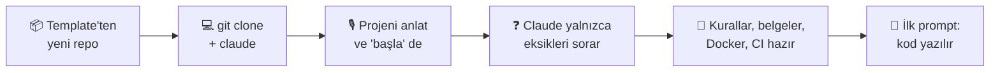

<div align="center">

# 🦴 Claude Proje İskeleti

**Projeni anlat, "başla" de. Claude sorularını sorsun, kurallarını yazsın, yığınını kursun.**
**İlk prompt'unda kod, senin kurallarınla yazılsın.**

[](https://claude.com/claude-code)
[](#-hazır-yığınlar)
[](#-hazır-yığınlar)
[](#-hazır-yığınlar)
[](#-hazır-yığınlar)
[](#)

</div>

---

Yapay zekâyla proje başlatmanın en yavaş kısmı kod değil, **bağlamdır**:
- ürün ne?
- kim ne yapabilir?
- hangi kurallar geçerli?
- testler nerede çalışır?
- veri nasıl korunur?

Bu iskelet o kısmı bir sohbete indirir. Projeyi bir kez anlatırsın; Claude eksikleri sorar ve projenin kendi iskeletini kurar: kurallar, mantık belgeleri, Docker ortamı, testler, CI. Sonra tek bir prompt'la kod yazılmaya başlar.

## ✨ Nasıl çalışır?



### 1. Template'ten yeni repo aç
GitHub'da bu repoda **Use this template → Create a new repository**.

### 2. Bilgisayarına al ve Claude Code'u aç
```bash
git clone git@github.com:<sen>/<yeni-proje>.git
cd <yeni-proje>
claude
```

### 3. Projeni anlat, "başla" de
Mikrofonu aç, istediğin kadar uzun anlat. Dağınık olabilir; Claude toparlar:

> *"Restoranlar için bir QR menü sitesi yapacağım. Laravel olsun. Bir süper admin olacak, işletmeleri o ekleyecek. Her işletme kendi menüsünü düzenleyecek; kategoriler, ürünler, fiyatlar. Müşteri masadaki QR'ı okutunca menüyü telefonda görecek. Tasarım sade ve modern olsun… başla."*

### 4. Claude sorar, sen seçersin
Claude önce **anladıklarını** özetler, sonra yalnızca anlatmadıklarını sorar. Sorular şıklıdır, ilk şık önerisidir:

```text
? Süper admin işlemleri değiştirilemez bir denetim kaydına yazılsın mı?
  ❯ Evet, denetim kaydı açılsın (Önerilen)
    Hayır, basit bir site
? Yedekler nereye alınsın?
  ❯ Sunucu klasörü + Backblaze B2 uzak kopya (Önerilen)
    Yalnızca sunucu klasörü
```

Sonra projeye özel **kurallar** ("her işletme yalnızca kendi menüsünü görür"), tekrar eden işler için **skill'ler** ve **mantık belgeleri** önerir. Belgeleri seninle birlikte, sözleşme soruları sorarak yazar: kim neyi yapabilir, hangi durumlar var, kenar durumlarda ne olur.

### 5. İlk prompt
Onboarding bitince elinde `docs/proje/ilk-istem.md` olur. Bu dosyayı birlikte yazarsınız: hedef, sayfalar, tasarım, kapsam dışı, "bitti" ölçütü. Hazır olduğunda:

> **"docs/proje/ilk-istem.md dosyasını uygula."**

Kod oluşur, konteynerler açılır, testler çalışır. Hepsi senin kurallarınla.

## 🧱 `/basla` sonunda projende neler olur?

```text
yeni-proje/
├── CLAUDE.md                     projeni anlatan giriş dosyası
├── .claude/
│   ├── rules/                    her oturumda geçerli kurallar (+ projeye özel olanlar)
│   ├── skills/                   /yigin, /kural, /changelog, /td ...
│   ├── hooks/                    kuralları zorlayan bekçiler
│   └── iskelet.json              açık korumalar, sürüm, kaldırılanlar
├── docs/
│   ├── proje/hakkinda.md         ürün, roller, kapsam
│   ├── proje/yigin.md            yığın, portlar, servisler
│   ├── proje/ilk-istem.md        ilk prompt'un
│   ├── mantik/*.md               davranışların sözleşmeleri
│   └── kayitlar/                 değişiklik ve teknik borç defterleri
├── compose.local.yaml            yerel ortam (canlıya çok benzer)
├── compose.live.yaml             canlı ortam
├── Makefile                      make up / test / lint / doctor / ci
└── .github/workflows/test.yml    her push'ta testler
```

Kullanılmayan her şey silinir: açılmayan isteğe bağlı kurallar, istemediğin çekirdek kurallar, gereksiz skill'ler. Silinenler iskelette durur; istersen geri gelir.

## 🛡️ Kurallar: Claude neye uyar?

| Kural | Ne der |
|---|---|
| **Dürüstlük** | Uydurma yok. Çalıştırılmayan test "geçti" sayılmaz. |
| **Soru** | Belirsizlikte şıklı soru; yığın, veri modeli, silme gibi büyük kararlar sana kalır. |
| **Plan** | Geniş işte önce plan modu; onaysız kod yok. |
| **Git** | Git salt okunur; commit ve push senin işin. |
| **Veri** | Veritabanı silinmez, testler ayrı bir `testing` veritabanında çalışır, gizli değer dosyaya yazılmaz. |
| **Docker** | PHP, Node, Python bilgisayarda değil konteynerde çalışır. |
| **Etki** | Davranış değişince testler ve arayüz aynı işte güncellenir. |
| **Mantık belgeleri** | Önce belge okunur; belgeler seninle birlikte yazılır. |
| **Kayıtlar** | Her değişiklik deftere tek satır; atlanan iş teknik borç olarak yazılır. |

Kuralların bir kısmı yalnızca metin değildir; **hook'larla zorlanır**. Örnekler:
- `git push` reddedilir;
- `docker compose down -v` reddedilir;
- defterin üzerine yazmak reddedilir;
- `.env.example` dosyasına değer yazmak reddedilir.

Bir kural istemiyorsan, örneğin Git salt okunur olmasın diyorsan, `/basla` sırasında söylemen yeterli: kural ve bekçisi birlikte kapanır.

## 📦 Hazır yığınlar

| Yığın | İçerik | Ekler |
|---|---|---|
| **laravel-next** | Laravel 13 (PHP 8.4) API + Next.js 16 + Postgres 17 + Redis 8 + Sanctum | Horizon kuyrukları, scheduler, Mailpit, Playwright e2e. İlk üçüyle adı **oben-stack** |
| **fastapi-next** | FastAPI (Python 3.13, SQLAlchemy 2 async, Alembic) + Next.js 16 + Postgres + Redis, `/api/v1` sürümleme | Celery (kısa ve uzun işler), beat, Flower, Mailpit, Playwright e2e |

İkisinde de:
- **Proje başına her şey ayrı:** kendi Traefik'i, Mailpit'i ve Docker soket vekili. Ortak servis yok.
- **Çakışmayan portlar:** portlar proje numarasından türer (Traefik `80NN`, Postgres `54NN`, Redis `63NN`), iki proje yan yana çalışır.
- **Canlı ortam:** Nginx Proxy Manager → Traefik → servisler.
- **Yalıtılmış testler:** ayrı bir `testing` veritabanı ve test kodunu yanlış veritabanında durduran koruma.
- **Kurulum betiği:** `kur.py` ayarları yazar, yerel `.env` değerlerini üretir. İlk prompt'ta kodu konteynerde oluşturur, uygulamayı açar, testleri çalıştırır. Yarıda kalırsa kaldığı yerden devam eder.

## 🧩 İsteğe bağlı kurallar

`/basla` ihtiyacına göre açar, gerisini siler:

| Kural | Ne getirir |
|---|---|
| **denetim-kaydi** | Kim, ne zaman, neyi, neyden neye değiştirdi. Postgres'te hash zincirli, değiştirilemez kayıt. |
| **cerez-ve-izleme** | Çerez onayı (onay öncesi betik yok), GA4 veya Umami, giriş ve IP güvenlik kaydı; saklama süresi dolunca kişisel veri anonimleşir. |
| **yedekleme** | Günlük `pg_dump` ve doğrulama, 7 günlük / 4 haftalık / 6 aylık saklama, haftalık geri yükleme sınaması, rclone ile uzak kopya. |

## ⌨️ Günlük komutlar

| Komut | İş |
|---|---|
| `make up` / `make down` | yerel ortamı aç, kapat |
| `make test` | backend ve frontend testleri |
| `make test-e2e` | Playwright uçtan uca testler |
| `make lint` | pint / ruff + ESLint |
| `make logs s=backend` | son loglar |
| `make sh` | backend kabuğu |
| `make migrate` | veritabanı göçleri |
| `make doctor` | `.env` sırası, compose, Docker, port kontrolü |
| `make ci` | temiz makinede baştan sona; GitHub Actions bunu çağırır |

## 🔄 İskelet güncellendi mi?

Önceden açtığın bir projede:

```text
/iskelet-guncelle ~/projeler/claude-project-skeleton
```

Farklar gösterilir, dosyalar tek tek sorularak kopyalanır. Projede değiştirdiğin satırlar korunur; silmiş olduğun kurallar yeniden önerilmez.

## 📋 Gerekenler

- [Claude Code](https://claude.com/claude-code)
- Docker (Compose v2)
- `make` ve `python3`

PHP, Composer, Node veya Python kurmana gerek yok; hepsi konteynerde.

## 🛠️ İskeleti geliştirenler için

- Bu deponun kendisi `.claude/iskelet.json` içinde `"tur": "iskelet"` taşır. İskeletin kendi geçmişi `.claude/iskelet-gecmisi/` altındadır. Template'ten açılan projede `/basla` bu alanı `proje` yapar ve geçmişi siler.
- Hook değişince testler çalıştırılır:
  ```bash
  python3 .claude/hooks/hook_testleri.py
  ```
- Yeni bir hazır yığının nasıl ekleneceği `.claude/skills/yigin/SKILL.md` dosyasında yazar. Her yığın eklenmeden önce baştan sona denenir.
- Hook'lar güçlü bir emniyet kemeridir ama yüzde yüz koruma değildir: başka bir dilin içinden yapılan çağrıları yakalamaz. Asıl güvence, kuralların metni ve plan onayıdır.

<div align="center">

**İşine yaradıysa bir ⭐ bırak; bir sonraki projen için hatırlatıcı olsun.**

</div>
